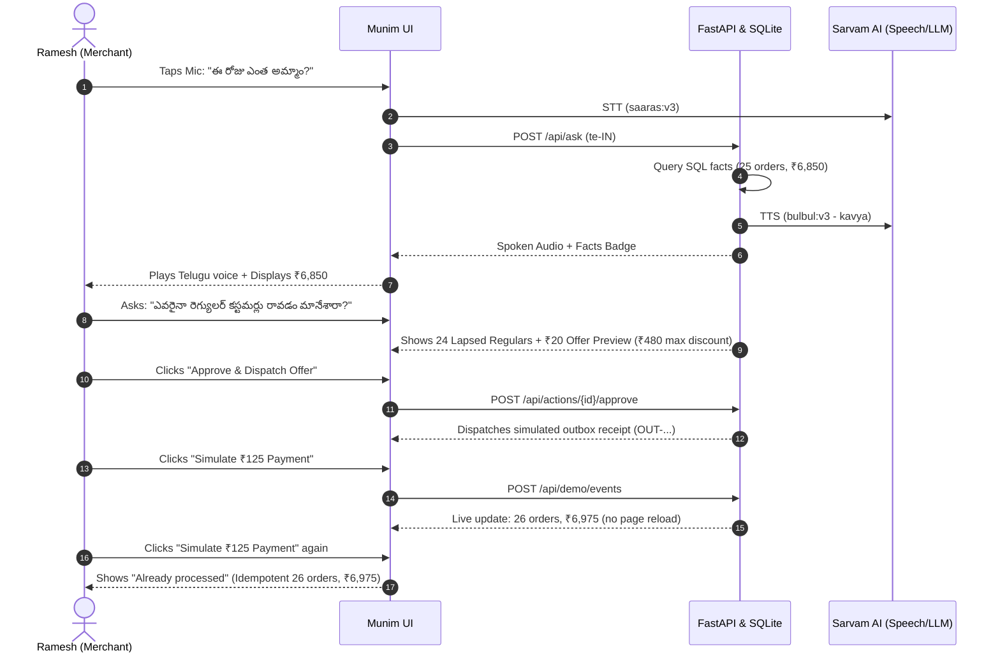

# Munim (మునీమ్ / मुनीम) — Merchant Growth AI
> **Paytm Build for India AI Hackathon — Track 1: Merchant Growth AI**  
> **Voice-First Business Assistant for Small Indian Merchants**  
> **Local Demo URL:** [http://localhost:8000](http://localhost:8000)  
> **API Health URL:** [http://localhost:8000/api/health](http://localhost:8000/api/health)  
> **API Documentation (Swagger):** [http://localhost:8000/api/docs](http://localhost:8000/api/docs)  

---

## 1. Overview

**Munim** is a voice-first merchant growth assistant designed for small Indian shopkeepers (kirana store owners, tiffin centres, local traders) who prefer speaking in their mother tongue over tapping complex software menus.

Tested and demonstrated with **Ramesh Kirana (`M01`)**, a Hyderabad grocery store owner who speaks **Telugu (`te-IN`)**. Munim speaks, calculates, alerts, and drafts outbound growth actions—while strictly computing all numbers from verified database facts with no hallucinations.

### Key Capabilities
- **Multilingual Voice Flow:** Native Telugu (`te-IN`), Hindi (`hi-IN`), and Indian English (`en-IN`) speech-to-text and speech synthesis powered by provisioned **Sarvam AI (`saaras:v3` & `bulbul:v3`)**.
- **Verified Business Metrics:** 100% database-calculated sales totals, hourly peak periods, margin analytics, and settlement alerts.
- **Overdue Settlement Alert:** Immediate warning on delayed UPI payouts (₹580 overdue from 10 Nov 2026).
- **Lapsed Regulars Win-Back:** Identifies 24 opted-in customers who visited &ge;3 times but lapsed (&ge;15 days), drafting an atomic ₹20 promotional voucher preview (₹480 max discount exposure).
- **Live Payment Simulation:** Real-time QR payment simulation (`M01-LIVE-001` for ₹125) that updates dashboard totals from **25 orders / ₹6,850** to **26 orders / ₹6,975** without page reload, with strict idempotency.
- **Excel / CSV Import Engine:** Validates external sales sheets with row-level error checking before atomic commit.
- **Unified Single-Origin Deployment:** React 18 + Vite frontend and FastAPI backend served on the exact same HTTP/HTTPS origin.

---

## 2. Baseline Verification Against `expected_demo.json`

Every single synthetic benchmark defined in `data/expected_demo.json` was verified:

| Metric | Expected Value | Actual Munim Value | Status |
| :--- | :--- | :--- | :--- |
| **Merchants Seeded** | 3 | 3 | Verified |
| **Customers Seeded** | 360 | 360 | Verified |
| **Suppliers Seeded** | 12 | 12 | Verified |
| **Products Seeded** | 24 | 24 | Verified |
| **Sales Seeded** | 8,296 | 8,296 | Verified |
| **Sale Items Seeded** | 13,364 | 13,364 | Verified |
| **Expenses Seeded** | 45 | 45 | Verified |
| **Supplier Bills Seeded** | 39 | 39 | Verified |
| **Settlements Seeded** | 270 | 270 | Verified |
| **M01 Final Day Paid Orders (2026-11-13)** | **25** | **25** | Verified |
| **M01 Final Day Sales (2026-11-13)** | **₹6,850** (685,000 paise) | **₹6,850** (685,000 paise) | Verified |
| **M01 Overdue Settlement** | **₹580** (58,000 paise) | **₹580** (58,000 paise) | Verified |
| **M01 Opted-In Lapsed Regulars** | **24 customers** | **24 customers** | Verified |
| **Post-Live Event Sales (₹125 added)** | **26 orders / ₹6,975** | **26 orders / ₹6,975** | Verified |
| **Duplicate Event Re-submission** | **26 orders / ₹6,975** | **26 orders / ₹6,975** | Verified (Idempotent) |

---

## 3. Quick Start (Run Locally)

### Prerequisites
- Python 3.10+ (tested on Python 3.14)
- Node.js 18+ and npm (tested on Node v24)

### 1. Extract Dataset (if needed)
If `data/` is not in the workspace root, extract `Munim_Hackathon_Kit.zip`:
```bash
Expand-Archive -Path "Munim_Hackathon_Kit.zip" -DestinationPath "." -Force
```

### 2. Configure Environment (`.env`)
Copy `.env.example` to `.env`:
```bash
cp .env.example .env
```
Ensure `SARVAM_API_KEY` is set to the organizer's provisioned key:
```env
PORT=8000
HOST=0.0.0.0
DATABASE_URL=sqlite:///./munim.db
SARVAM_API_KEY=your_sarvam_api_key_here
SARVAM_CHAT_MODEL=sarvam-105b
SARVAM_TTS_MODEL=bulbul:v3
SARVAM_STT_MODEL=saaras:v3
DEMO_BUSINESS_DATE=2026-11-13
TIMEZONE=Asia/Kolkata
DEFAULT_MERCHANT_ID=M01
```

### 3. Build Frontend
```bash
npm run build --prefix frontend
```
*(Produces optimized static bundle in `frontend/dist` which FastAPI automatically serves at `/`)*

### 4. Start Unified Server
```bash
python -m uvicorn backend.app.main:app --host 0.0.0.0 --port 8000
```
Open **[http://localhost:8000](http://localhost:8000)** in your browser!

### 5. Run Automated Smoke Test Suite
In a separate terminal:
```bash
python scripts/smoke_test.py
```
*(Runs all 7 end-to-end integration tests in under 15 seconds)*

---

## 4. The Signature Judge Demo Script (4 Steps)

Follow this 2-minute live demo sequence during hackathon judging:



1. **Step 1: Spoken Daily Brief in Telugu**
   - Click the big microphone (or click the quick question chip: **"ఈ రోజు ఎంత అమ్మాం?"**).
   - Munim speaks in natural Telugu:
     > *"ఈ రోజు 25 ఆర్డర్లలో మొత్తం ₹6,850 వ్యాపారం జరిగింది. పీక్ సమయం 6 PM – 8 PM."*
   - The UI displays **25 paid orders** and **₹6,850**, matching spoken audio 1:1.

2. **Step 2: Proactive Opportunity & Settlement Alert**
   - Click quick chip: **"సెటిల్మెంట్ పరిస్థితి ఏమిటి?"**
   - Munim highlights the **₹580 overdue settlement** from Nov 10 (`M01-U086`) and ₹4,945 pending.
   - Click quick chip: **"ఎవరైనా రెగ్యులర్ కస్టమర్లు రావడం మానేశారా?"**
   - Munim identifies **24 opted-in regular customers** who haven't visited in 15+ days.

3. **Step 3: Atomic Win-Back Approval Flow**
   - Munim automatically renders the stored action preview:
     - 24 eligible customers
     - ₹20 promotional voucher
     - ₹480 maximum discount exposure
     - Sample message: *"నమస్కారం! రమేష్ కిరాణా నుండి మీకోసం ₹20 ప్రత్యేక ఆఫర్! ఈ రోజే రండి."*
   - Tap **"Approve & Dispatch ₹20 Offer"**.
   - Munim records an immutable audit record and displays the simulated outbox receipt (`OUT-...`, 24 delivered). Retrying approval safely returns the existing receipt without duplicate dispatch.

4. **Step 4: Live Payment Simulation (Paytm Soundbox)**
   - Click the **"Simulate ₹125 Payment"** button.
   - Dashboard instantly updates from **25 orders / ₹6,850** to **26 orders / ₹6,975** without page reload!
   - Ask *"ఈ రోజు ఎంత అమ్మాం?"* again &rarr; spoken answer immediately reports **26 orders and ₹6,975**.
   - Click **"Simulate ₹125 Payment"** a second time &rarr; system returns `Already processed (Idempotent)` and totals remain strictly at 26 orders / ₹6,975.
   - Click **"Reset Demo"** in header anytime to reset the rehearsal state back to 25 orders / ₹6,850.

---

## 5. API Endpoints Contract

All endpoints run on the same origin (`/api/...`):

| Method | Endpoint | Description |
| :--- | :--- | :--- |
| `GET` | `/api/health` | Health probe, active DB engine, dataset date, Sarvam AI config and call counter. |
| `GET` | `/api/merchants` | List available demo merchants (`M01` Ramesh Kirana, `M02` Asha Tiffins, `M03`). |
| `GET` | `/api/dashboard` | Returns verified sales, peak period, settlements, margins, lapsed customers, top products. |
| `POST` | `/api/ask` | Natural language question & voice processing with verified facts & TTS audio. |
| `POST` | `/api/actions/preview` | Generates immutable winback offer preview for opted-in lapsed regulars. |
| `POST` | `/api/actions/{id}/approve` | Atomic, idempotent merchant approval with simulated outbox dispatch. |
| `POST` | `/api/demo/events` | Accepts `simulated_event.json` live payment with idempotent keying. |
| `POST` | `/api/demo/reset` | Resets synthetic database back to pristine baseline for rehearsals. |
| `POST` | `/api/import/preview` | Uploads `.csv` or `.xlsx`, performs row-level validation and schema mapping. |
| `POST` | `/api/import/commit` | Commits validated spreadsheet records atomically within a transaction. |
| `POST` | `/api/voice/stt` | Transcribes audio clip using Sarvam `saaras:v3`. |
| `POST` | `/api/voice/tts` | Synthesizes localized speech using Sarvam `bulbul:v3`. |

---

## 6. Architecture & Security Boundaries

- **Database Independence:** Default is zero-dependency SQLite with persistent storage (`munim.db`). If `DATABASE_URL` is set to Supabase PostgreSQL, the unified SQLAlchemy data access layer seamlessly switches without code modification.
- **AI Security Guardrails:** LLM inference is restricted strictly to intent classification. All financial figures, order counts, gross profits, and recipient lists are computed purely by deterministic Python/SQL code.
- **Secret Isolation:** API keys and connection strings exist exclusively in backend environment variables. No secrets are exposed to the frontend, browser requests, or Git repository.
- **Development Call Tracking:** In-memory counter records provider calls to monitor Sarvam credit usage without storing recordings or customer transcripts.
