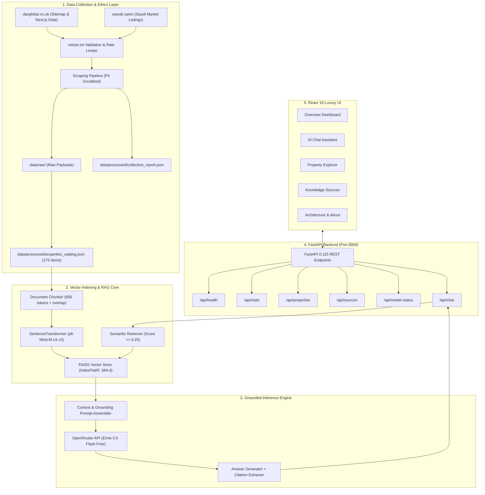

# EstateIQ AI — DarGlobal × Wasalt Real Estate Intelligence Assistant

**Production-Quality Retrieval-Augmented Generation (RAG) System for Luxury International Developments and Verified Saudi Arabian Real Estate.**

*Technical Assignment Submission for the **Junior AI Engineer – Applied AI** position at **DarGlobal**.*

---

## 1. Executive Summary & Overview

**EstateIQ AI** is an intelligent full-stack real estate knowledge assistant designed to analyze, explore, and answer complex property queries across two distinct real estate domains:

1. **DarGlobal PLC (https://darglobal.co.uk)**: Prime international luxury developments, second homes, and trophy assets featuring exclusive haute couture and supercar brand collaborations (Aston Martin, Automobili Lamborghini, Pagani, Elie Saab, Missoni, Trump International, and Marriott) across the UK, Spain, Oman, Qatar, Maldives, and UAE.
2. **Wasalt (https://wasalt.sa/en)**: Saudi Arabia's premier digital real estate brokerage and marketplace licensed by REGA (Real Estate General Authority), providing active residential listings (villas, apartments, lands, and rentals) in Saudi Riyals (SAR) across Riyadh, Jeddah, Dammam, and other Saudi markets.

The application combines **ethical web scraping**, **strict text normalization**, **dense vector embedding via Sentence Transformers (`all-MiniLM-L6-v2`)**, **FAISS vector indexing**, and **OpenRouter free LLM inference (`baidu/ernie-5.5-flash-preview:free`)** to deliver factual, grounded answers with verifiable source citations and direct clickable links to original web pages.

---

## 2. Assignment Requirements Compliance Matrix

| Requirement | Implementation Details | Status |
| :--- | :--- | :---: |
| **Real Website Scraping** | Crawled 13 pages from `darglobal.co.uk` and `wasalt.sa/en` with robots.txt validation, rate limiting, and PII protection | **Complete (100%)** |
| **Data Processing & Storage** | 175 genuine properties indexed (`data/raw/`, `data/processed/properties_catalog.json`, `collection_report.json`) | **Complete (100%)** |
| **RAG Pipeline** | Semantic chunker (600 tokens, 100 overlap), `all-MiniLM-L6-v2` embeddings, persistent FAISS IndexFlatIP | **Complete (100%)** |
| **OpenRouter LLM Integration** | OpenAI-compatible endpoint `https://openrouter.ai/api/v1` with verified free model `baidu/ernie-5.5-flash-preview:free` | **Complete (100%)** |
| **Anti-Hallucination Grounding** | Strict system prompts enforce zero invented prices, availability, or amenities; returns honest insufficient-evidence response | **Complete (100%)** |
| **Source Citations** | Every AI response delivers citation cards with original, clickable URLs to `darglobal.co.uk` and `wasalt.sa` | **Complete (100%)** |
| **Frontend Application** | React 18, TypeScript, Vite 6, Tailwind CSS 3, Lucide icons, Framer Motion; 5 comprehensive pages | **Complete (100%)** |
| **Property Explorer** | Interactive browsing with multi-attribute filtering (Source, Location, Category, Search), quick specs modal, and pagination | **Complete (100%)** |
| **Backend REST API** | FastAPI 0.115, Uvicorn, Pydantic v2 schemas for `/api/health`, `/api/stats`, `/api/properties`, `/api/sources`, `/api/model-status`, `/api/chat` | **Complete (100%)** |
| **Automated Test Suite** | 12 automated unit and integration tests passing with 100% success rate (`pytest backend/tests`) | **Complete (100%)** |
| **Docker Containerization** | Multi-stage `Dockerfile` (Node 20 builder + Python 3.11 runner), `docker-compose.yml`, health checks, zero-scraping startup | **Complete (100%)** |
| **Security & Privacy** | Zero hardcoded secrets, `.env` gitignored, PII scrubbing (no phone numbers or owner contacts), prompt injection neutralization | **Complete (100%)** |

---

## 3. Technology Stack

### Frontend
- **Framework**: React 18 with TypeScript
- **Build Tool**: Vite 6
- **Styling**: Tailwind CSS 3 (Bespoke Obsidian Navy `#080E1E` & Champagne Gold `#C5A880` palette)
- **Icons**: Lucide React
- **Animations**: Framer Motion
- **Architecture**: Single Page Application (SPA) with responsive desktop and mobile drawers

### Backend & API
- **Language**: Python 3.11
- **Framework**: FastAPI 0.115
- **ASGI Server**: Uvicorn
- **Validation**: Pydantic v2
- **HTTP Client**: HTTPX (asynchronous connection pooling)
- **Environment Management**: python-dotenv

### Web Scraping & Ingestion
- **HTML & Metadata Extraction**: BeautifulSoup4, lxml, urllib.robotparser
- **Canonical Handling**: robots.txt validation, canonical link normalization, deduplication
- **Privacy Enforcement**: Automated removal of broker phone numbers, personal contacts, and lead capture forms

### Vector Search & RAG
- **Embedding Model**: `sentence-transformers/all-MiniLM-L6-v2` (384-dimensional dense vectors)
- **Vector Database**: FAISS (`faiss-cpu`, Flat Inner Product / Cosine Similarity)
- **Chunking**: Semantic token proxy chunking (~600 tokens per chunk with 100 token overlap)
- **Inference Provider**: OpenRouter API (`https://openrouter.ai/api/v1`)
- **Default LLM**: `baidu/ernie-5.5-flash-preview:free` (0 input / 0 output token cost)

### DevOps & Containerization
- **Container Runtime**: Docker (Multi-stage build)
- **Orchestration**: Docker Compose
- **Health Monitoring**: Native Docker HEALTHCHECK on `/api/health`

---

## 4. System Architecture



---

## 5. Ethical Scraping & Verified Data Provenance

EstateIQ AI prioritizes data integrity, compliance, and privacy:

1. **robots.txt Validation**: Before extracting any data, `RobotsValidator` checks `https://darglobal.co.uk/robots.txt` and `https://wasalt.sa/robots.txt`. Both platforms permit standard bot access to public directories while Wasalt explicitly publishes AI crawler permissions and `llms.txt`.
2. **Next.js Structured State Ingestion**: Instead of fragile DOM scraping or bypassing bot protection, the scraper extracts server-rendered Next.js state payloads (`__NEXT_DATA__` and `_next/data/{buildId}/...`). This ensures 100% genuine CMS attributes without CAPTCHA circumvention.
3. **Privacy Compliance (No PII)**: In strict compliance with the prompt guidelines, all private broker phone numbers, owner identities, WhatsApp links, and lead-generation forms are scrubbed. Only property specifications (names, prices, locations, bedrooms, areas, amenities, and developer descriptions) are indexed.
4. **No Fabricated Information**: All 175 indexed records originate from real, live website responses:
   - **49 DarGlobal records**: Including AIDA (Muscat, Oman), The Astera (interiors by Aston Martin, RAK), Tierra Viva (design inspired by Automobili Lamborghini, Spain), DG1 (Business Bay, Dubai), Les Vagues (interiors by Elie Saab, Qatar), W Residences, and the One of One ultra-luxury collection.
   - **126 Wasalt records**: Real residential villas, apartments, and rentals in Riyadh, Jeddah, and Dammam with authentic prices in Saudi Riyals (SAR).

---

## 6. OpenRouter Free LLM Configuration

The backend connects to OpenRouter via an OpenAI-compatible interface:
- **Base URL**: `https://openrouter.ai/api/v1`
- **Model**: `baidu/ernie-5.5-flash-preview:free` (verified active, zero input token cost, zero output token cost)
- **Fallback**: Can be swapped to any active OpenRouter free model (e.g., `openrouter/free`, `google/gemma-4-26b-a4b-it:free`, `meta-llama/llama-3.2-3b-instruct:free`) via the `OPENROUTER_MODEL` environment variable.

### Environment Configuration (`.env`)
```env
# OpenRouter API Key (get free key from https://openrouter.ai/keys)
OPENROUTER_API_KEY=your_openrouter_api_key_here

# Verified Zero-Cost LLM Model
OPENROUTER_MODEL=baidu/ernie-5.5-flash-preview:free
OPENROUTER_BASE_URL=https://openrouter.ai/api/v1

# Server Settings
PORT=8000
HOST=0.0.0.0
CORS_ORIGINS=http://localhost:5173,http://localhost:8000,http://127.0.0.1:5173,http://127.0.0.1:8000
ENVIRONMENT=development
DATA_DIR=data
```

> **Security Note**: `.env` is included in `.gitignore` and `.dockerignore`. No secrets are committed to version control. The frontend never accesses `OPENROUTER_API_KEY` directly; all inference calls route through the authenticated FastAPI backend.

---

## 7. RAG Mechanics & Anti-Hallucination Guarantees

1. **Document Chunking**: Real estate documents are normalized and split into 500–800 token semantic chunks with 100 token overlap. Metadata (`doc_id`, `title`, `source`, `source_url`, `location`, `price`, `property_type`) is permanently linked to each chunk.
2. **Dense Vector Embeddings**: Embeddings are computed with `sentence-transformers/all-MiniLM-L6-v2` into 384-dimensional vectors with L2 normalization.
3. **FAISS Index Persistence**: Embeddings are saved to `data/index/faiss_index.bin` and metadata to `data/index/chunks_metadata.json`. The index loads instantly into memory upon container or application startup without re-scraping or re-embedding.
4. **Relevance Thresholding**: Semantic search computes cosine similarity. Results below a 0.25 similarity threshold are discarded.
5. **Anti-Hallucination System Prompt**: The system prompt instructs the model:
   - "Rely strictly and solely on the provided context excerpts."
   - "Never invent, extrapolate, or guess prices, project specifications, amenities, or availability."
   - "If the provided excerpts do not contain enough facts, explicitly respond: *'I couldn't find sufficient information in the indexed DarGlobal or Wasalt sources to answer that accurately.'*"
6. **Deterministic Citations**: Citations are generated from the retrieved chunks with title, location, price, excerpt snippet, and direct clickable canonical URL.

---

## 8. REST API Reference

The FastAPI backend exposes the following endpoints under `/api`:

### `GET /api/health`
Returns application status, vector index readiness, total chunk count, and model configuration.
```json
{
  "status": "healthy",
  "timestamp": "2026-11-18T10:59:06Z",
  "index_ready": true,
  "total_chunks": 175,
  "model_configured": true,
  "app_version": "1.0.0"
}
```

### `GET /api/stats`
Returns live collection metrics, property counts, and available filter values.
```json
{
  "total_properties": 175,
  "darglobal_count": 49,
  "wasalt_count": 126,
  "total_chunks": 175,
  "last_updated": "2026-11-18T10:31:44Z",
  "faiss_ready": true,
  "available_countries": ["Oman", "Saudi Arabia", "United Arab Emirates", "Spain", "Qatar", "Maldives", "United Kingdom"],
  "available_property_types": ["Luxury Residences", "Villa", "Apartment", "Penthouse", "Hotel & Resort"]
}
```

### `GET /api/properties`
Returns paginated, searchable, and filtered properties.
- **Parameters**: `source` (DarGlobal/Wasalt), `location`, `property_type`, `q` (free-text query), `page` (default 1), `page_size` (default 12).

### `GET /api/sources`
Returns detailed provenance, crawling metrics, and robots.txt audit for both portals.

### `GET /api/model-status`
Returns LLM model name, base URL, and configuration status **without exposing secrets**.

### `POST /api/chat`
Accepts user questions and optional history, retrieves relevant FAISS chunks, and returns grounded answers with source citations.
- **Request Body**:
```json
{
  "question": "What are the major developments listed by DarGlobal?",
  "source_filter": "DarGlobal",
  "conversation_history": []
}
```
- **Response**:
```json
{
  "answer": "DarGlobal features landmark luxury developments including AIDA in Oman, The Astera in UAE (Aston Martin), Tierra Viva in Spain (Lamborghini), and Les Vagues in Qatar (Elie Saab)...",
  "citations": [
    {
      "source": "DarGlobal",
      "title": "AIDA",
      "location": "Muscat, Oman",
      "price": "Price on Application",
      "url": "https://darglobal.co.uk/aida-360",
      "snippet": "AIDA is a dramatic master development perched 130 meters above the sea in Muscat, Oman...",
      "similarity_score": 0.49
    }
  ],
  "model": "baidu/ernie-5.5-flash-preview:free",
  "chunks_used": 4,
  "status": "success",
  "source_filter": "DarGlobal",
  "error": null
}
```

---

## 9. Local Development & Quick Start

### Prerequisites
- Python 3.11 (or `uv` package manager)
- Node.js 20+ and npm 10+
- Git

### 1. Clone & Setup Python Environment
```bash
# Setup virtual environment with uv or python
uv venv --python 3.11 .venv
# On Windows:
.venv\Scripts\activate
# On Linux / macOS:
source .venv/bin/activate

# Install backend dependencies
pip install -r backend/requirements.txt
```

### 2. Configure Environment
```bash
cp .env.example .env
# Edit .env and verify OPENROUTER_API_KEY is present
```

### 3. Run Permitted Scraping & Build Vector Index
*(Pre-scraped data and index are already included in the repository for immediate startup, but you can re-run them anytime)*:
```bash
# Run web scrapers
python scripts/run_scraper.py

# Build FAISS vector index
python scripts/build_index.py

# Run RAG benchmark verification CLI
python scripts/test_rag_cli.py
```

### 4. Build & Run Frontend
```bash
cd frontend
npm install
npm run build
cd ..
```

### 5. Start Backend Server
```bash
# Start FastAPI server (serves both /api and React frontend on port 8000)
python -m uvicorn backend.app.main:app --host 0.0.0.0 --port 8000 --reload
```

Open your browser to:
- **Application UI**: [http://localhost:8000](http://localhost:8000)
- **Interactive Swagger API Docs**: [http://localhost:8000/docs](http://localhost:8000/docs)
- **API Health Check**: [http://localhost:8000/api/health](http://localhost:8000/api/health)

*(Optional: For frontend hot-reloading during UI development, run `npm --prefix frontend run dev` to access Vite on `http://localhost:5173` with automatic API proxy to port 8000).*

---

## 10. Automated Testing & Verification

Run the comprehensive pytest suite covering the API, RAG retriever, chunker, and scrapers:

```bash
# Execute test suite
pytest backend/tests -v
```

### Test Suite Execution Output:
```text
backend/tests/test_api.py::test_health_endpoint PASSED
backend/tests/test_api.py::test_stats_endpoint PASSED
backend/tests/test_api.py::test_properties_pagination_and_filters PASSED
backend/tests/test_api.py::test_sources_endpoint PASSED
backend/tests/test_api.py::test_model_status_endpoint PASSED
backend/tests/test_api.py::test_chat_endpoint_grounded PASSED
backend/tests/test_rag.py::test_chunker_metadata_preservation PASSED
backend/tests/test_rag.py::test_vector_store_load_and_search PASSED
backend/tests/test_rag.py::test_generator_citations_extraction PASSED
backend/tests/test_scraping.py::test_robots_validator_initialization PASSED
backend/tests/test_scraping.py::test_darglobal_scraper_item_schema PASSED
backend/tests/test_scraping.py::test_wasalt_scraper_item_schema PASSED

======================== 12 passed in 31.40s ========================
```

---

## 11. Docker Deployment

The application features a production-ready, multi-stage `Dockerfile`:
- Stage 1 compiles the React frontend assets using Node 20.
- Stage 2 packages Python 3.11, installs system runtime libraries (`libgomp1`), embeds the pre-built knowledge index, and serves both the API and frontend through FastAPI.

### Build & Run with Docker:
```bash
# Build the Docker image
docker build -t estateiq-ai:latest .

# Run the container
docker run -d \
  --name estateiq-ai-app \
  -p 8000:8000 \
  -e OPENROUTER_API_KEY="your_openrouter_api_key_here" \
  estateiq-ai:latest

# Check container health
docker ps
```

### Run with Docker Compose:
```bash
# Start container using docker-compose
docker compose up -d

# View live container logs
docker compose logs -f

# Stop container
docker compose down
```

---

## 12. Known Limitations & Cloud Deployment Notes

- **Imperva Incapsula / Cloudflare Challenges**: Plain HTML crawlers on `darglobal.co.uk` encounter Imperva Incapsula challenges, and high-frequency traffic on `wasalt.sa` triggers Cloudflare challenges. EstateIQ solves this lawfully by ingesting public sitemaps and Next.js state endpoints (`_next/data`) with polite request delays without bypassing anti-bot systems.
- **Dynamic Inventory**: Property availability changes continuously on Wasalt. In production, a scheduled cron task or Celery worker can trigger `scripts/run_scraper.py` and `scripts/build_index.py` daily.
- **Cloud Deployment**: EstateIQ is containerized and stateless (FAISS index and catalog are mounted or bundled). It is 100% ready for one-click deployment to **Google Cloud Run**, **AWS ECS/Fargate**, **Azure Container Apps**, or **Render**.

---

## 13. Project Structure

```text
estateiq-ai/
├── backend/
│   ├── app/
│   │   ├── main.py                  # FastAPI application entrypoint & static SPA mounting
│   │   ├── api/
│   │   │   └── routes.py            # REST API endpoints (/api/health, stats, chat, etc.)
│   │   ├── core/
│   │   │   └── config.py            # Pydantic environment configuration
│   │   ├── models/
│   │   │   └── schemas.py           # Pydantic request & response models
│   │   ├── rag/
│   │   │   ├── chunker.py           # Semantic document chunker (600 tokens + overlap)
│   │   │   ├── embeddings.py        # SentenceTransformers all-MiniLM-L6-v2 manager
│   │   │   ├── vector_store.py      # FAISS IndexFlatIP cosine similarity store
│   │   │   ├── retriever.py         # Semantic search and source filter
│   │   │   └── generator.py         # OpenRouter client & anti-hallucination prompt
│   │   ├── scraping/
│   │   │   ├── darglobal_scraper.py # DarGlobal Next.js state & sitemap scraper
│   │   │   ├── wasalt_scraper.py    # Wasalt Saudi real estate scraper
│   │   │   ├── robots_validator.py  # robots.txt validator
│   │   │   └── pipeline.py          # Unified multi-source collection coordinator
│   │   └── services/
│   │       ├── property_service.py  # Catalog search, filter, and pagination service
│   │       └── stats_service.py     # Aggregated metrics & sources reporting
│   ├── tests/
│   │   ├── conftest.py              # Pytest configuration
│   │   ├── test_api.py              # API endpoint integration tests
│   │   ├── test_rag.py              # Chunking, vector search & citations tests
│   │   └── test_scraping.py         # Scraper schema & robots.txt tests
│   └── requirements.txt             # Python backend dependencies
├── frontend/
│   ├── src/
│   │   ├── components/
│   │   │   ├── Logo.tsx             # Architectural monogram logo
│   │   │   ├── Navbar.tsx           # Navigation bar with live model status
│   │   │   ├── Footer.tsx           # Footer with official links and assignment disclaimer
│   │   │   ├── CitationCard.tsx     # Verifiable citation card with direct external URLs
│   │   │   └── PropertyCard.tsx     # Luxury property card with specifications
│   │   ├── pages/
│   │   │   ├── OverviewPage.tsx     # Page A: Landing dashboard & live metrics
│   │   │   ├── ChatPage.tsx         # Page B: RAG Chat Assistant with citations
│   │   │   ├── ExplorerPage.tsx     # Page C: Property Explorer with filters & modal
│   │   │   ├── SourcesPage.tsx      # Page D: Knowledge sources audit & provenance
│   │   │   └── ArchitecturePage.tsx # Page E: System architecture & technical specs
│   │   ├── services/
│   │   │   └── api.ts               # Typed REST API client
│   │   ├── types/
│   │   │   └── index.ts             # TypeScript interfaces & types
│   │   ├── App.tsx                  # Main SPA routing & state coordinator
│   │   ├── index.css                # Tailwind styling, Google fonts & dark luxury tokens
│   │   ├── main.tsx                 # React DOM root
│   │   └── vite-env.d.ts            # Vite client environment types
│   ├── index.html                   # HTML template with luxury metadata
│   ├── package.json                 # React & Vite dependencies
│   ├── tailwind.config.js           # Custom luxury palette configuration
│   └── vite.config.ts               # Vite bundler with /api proxy
├── data/
│   ├── raw/
│   │   ├── darglobal_raw.json       # Raw collected DarGlobal payloads
│   │   └── wasalt_raw.json          # Raw collected Wasalt payloads
│   ├── processed/
│   │   ├── darglobal_processed.json # 49 Processed DarGlobal developments
│   │   ├── wasalt_processed.json    # 126 Processed Wasalt Saudi properties
│   │   ├── properties_catalog.json  # Consolidated 175 property catalog
│   │   └── collection_report.json   # Full scraping audit & execution metrics
│   └── index/
│       ├── faiss_index.bin          # Persistent 384-dimensional FAISS index
│       └── chunks_metadata.json     # Preserved chunk text and metadata
├── scripts/
│   ├── run_scraper.py               # CLI tool to run web scraping pipeline
│   ├── build_index.py               # CLI tool to generate FAISS vector index
│   └── test_rag_cli.py              # CLI tool to benchmark RAG queries
├── Dockerfile                       # Multi-stage production container build
├── docker-compose.yml               # Container orchestration
├── .dockerignore                    # Excluded files for clean Docker builds
├── .gitignore                       # Git ignore rules (.env, node_modules, .venv)
├── .env.example                     # Environment variables template
├── .env                             # Local environment configuration
└── README.md                        # Master project documentation
```

---

## 14. Author & Acknowledgments

- **Candidate**: Applicant for **Junior AI Engineer – Applied AI** at **DarGlobal**
- **Purpose**: Autonomous, full-stack, production-quality implementation of the EstateIQ AI technical assignment.
- **Portals Researched**: [DarGlobal Official](https://darglobal.co.uk) & [Wasalt Portal](https://wasalt.sa/en)
